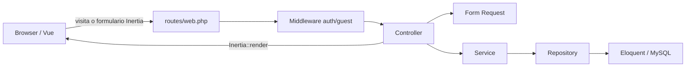
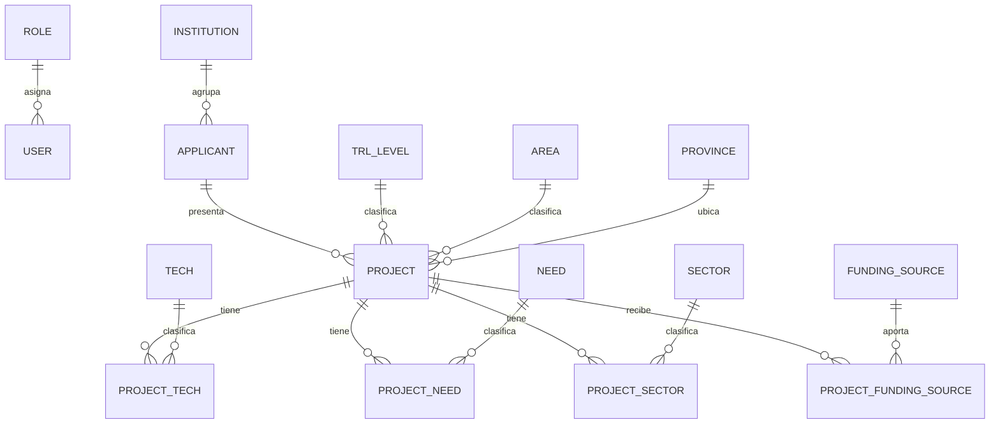

# Arquitectura y modelo de datos

## Visión general

La aplicación es un monolito Laravel con frontend Vue entregado mediante Inertia. No expone una API pública separada: las rutas web ejecutan controladores Laravel, que devuelven respuestas Inertia o redirecciones con mensajes flash.

## Dominios

### Users

Ruta: `app/Domains/Users`.

Responsabilidades:

- registro, login y logout;
- consulta y actualización de perfil;
- cambio de contraseña;
- listado y detalle de usuarios;
- roles `admin` y `usuario`.

El acceso administrativo se resuelve actualmente comparando `role_id === 1` dentro de `UserController`. Los registros nuevos reciben `role_id = 2` mediante el valor por defecto del modelo, sin aceptar escalamiento desde el formulario.

### Projects

Ruta: `app/Domains/Projects`.

Responsabilidades:

- listado paginado con filtros;
- carga del detalle y relaciones;
- actualización de campos escalares del proyecto;
- eliminación;
- modelos y repositorios de catálogos usados por la importación.

`ProjectRepository` concentra las consultas Eloquent. El listado selecciona sólo las columnas necesarias, precarga solicitante, TRL y provincia, y ordena por ID descendente.

### Files

Ruta: `app/Domains/Files`.

Responsabilidades:

- validar y almacenar el CSV en el disco local privado;
- registrar el intento en `imports`;
- transformar cada fila en una estructura normalizada;
- resolver catálogos, valores personalizados y jerarquías;
- persistir el conjunto dentro de una transacción.

El nombre `Files` representa hoy exclusivamente importaciones de proyectos.

## Flujo de una petición

1. `routes/web.php` selecciona el controlador y exige `auth` o `guest`.
2. El Form Request autoriza y valida los datos de entrada.
3. El controlador delega el caso de uso al servicio.
4. El servicio coordina uno o más repositorios.
5. El repositorio consulta o modifica modelos Eloquent.
6. El controlador devuelve una página Inertia o una redirección con flash `success`/`error`.

`HandleInertiaRequests` comparte con todas las páginas el usuario autenticado —sin contraseña— y los mensajes flash.

## Frontend

- Entrada: `resources/js/app.js`.
- Páginas: `resources/js/Pages`.
- Layout autenticado: `resources/js/Layouts/AppLayout.vue`.
- Layout de acceso: `resources/js/Layouts/AuthLayout.vue`.
- Componentes reutilizables: `resources/js/Components`.
- Primitivas UI: `resources/js/Components/ui`.
- Estilos y variables de tema: `resources/css/app.css`.

Vite resuelve el alias `@` hacia `resources/js`. Los enlaces y endpoints del frontend están mayormente escritos como rutas literales; al modificar rutas backend hay que buscar y actualizar sus consumidores Vue.

Hay una inconsistencia de mayúsculas en `resources/js/Pages/Projects/index.vue` frente al resto de páginas. Debe preservarse exactamente el casing de cada componente, especialmente al desplegar en Linux.

## Modelo relacional

Tablas de infraestructura Laravel: `sessions`, `password_reset_tokens`, `cache`, `cache_locks`, `jobs`, `job_batches` y `failed_jobs`.

Tablas del producto:

- `roles`, `users`;
- `imports`;
- `institutions`, `applicants`, `projects`;
- `trl_levels`, `areas`, `provinces`;
- `techs`, `needs`, `sectors`, `funding_sources`;
- pivotes `projects_techs`, `projects_needs`, `projects_sectors` y `projects_funding_sources`.

El pivote de financiamiento guarda además `percentage`. `needs` y `sectors` son jerárquicos mediante una referencia a su misma tabla.

Los nombres `SID`, `IP_address`, `company_CUIT` y `EBCT_amount` son heredados y no siguen la convención snake_case. No deben renombrarse sin una migración compatible y la actualización conjunta del parser, modelos, frontend y pruebas.

## Catálogos

La importación depende de que existan datos de referencia. `DatabaseSeeder` carga, en este orden:

1. roles;
2. provincias;
3. áreas;
4. sectores;
5. niveles TRL;
6. tecnologías;
7. fuentes de financiamiento;
8. necesidades;
9. instituciones;
10. usuario administrador inicial.

Algunos algoritmos todavía presuponen IDs concretos —por ejemplo, roles 1/2 y el ID 3 para la necesidad padre "Equipamiento"—. Conservar el orden del seeding hasta eliminar esas dependencias.

## Decisiones y límites actuales

- No hay SSR configurado: la aplicación se renderiza del lado cliente.
- No hay API versionada ni consumidores externos documentados.
- No hay Policies/Gates para proyectos o importaciones; cualquier usuario autenticado accede a esas operaciones.
- La importación es síncrona aunque la cola use el driver `database`.
- `Project` y los catálogos no usan timestamps Laravel; el proyecto conserva fechas propias del sistema fuente.
- La migración principal del dominio reúne muchas tablas en un solo archivo heredado.
