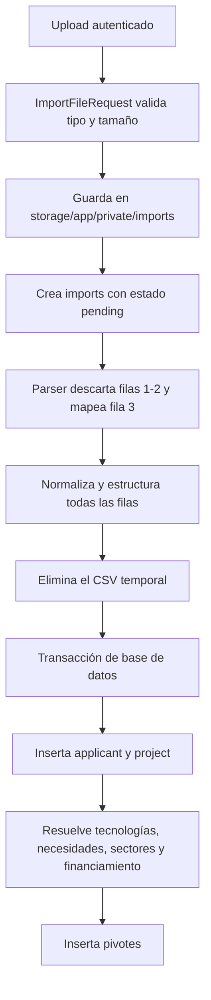

# Contrato y flujo de importación CSV

## Objetivo

El importador transforma una exportación CSV de proyectos en solicitantes, proyectos y relaciones con catálogos. El endpoint está protegido por autenticación y acepta archivos CSV o texto de hasta 10 MB.

Ruta backend vigente:

```text
GET  /file/add   (file.create)
POST /file/add   (file.store)
```

La pantalla Vue contiene actualmente un endpoint POST obsoleto (`/projects/add`). Consulte [HANDOVER.md](HANDOVER.md) antes de probar el flujo desde la interfaz.

## Estructura física esperada

- Codificación: conservar la codificación de la exportación original.
- Separador: coma `,`.
- Delimitador de texto: comillas dobles `"`.
- Filas 1 y 2: descriptivas; el parser las descarta.
- Fila 3: encabezados.
- Fila 4 en adelante: un proyecto por fila.
- Tamaño máximo: 10 MB.

El parser normaliza espacios y tabulaciones. Para localizar columnas, normaliza encabezados y busca coincidencias parciales con los textos configurados en `ProjectImportParser::HEADER_MAPPING`. Si no encuentra un encabezado, usa un índice fijo heredado. Por eso el contrato seguro exige conservar tanto los encabezados como el orden original.

## Grupos de datos

El archivo aporta aproximadamente 75 columnas agrupadas de esta manera:

- Metadatos: SID y fechas de envío, finalización y modificación.
- Proyecto: título, fechas, objetivo, diferencia innovativa, TRL y vertical.
- Solicitante: usuario, nombre, correo, teléfono, CUIL e IP.
- Institución/empresa: tipo, nombre, CUIT y entidad de radicación.
- Ubicación: provincia y países.
- Tecnologías: selección predefinida y texto "otro".
- Sectores: sector general y subsectores distribuidos en varias columnas.
- Financiamiento público y privado: selecciones, porcentajes y valores personalizados.
- Necesidades: necesidades generales, equipamiento, propiedad intelectual y textos personalizados.
- EBCT/Startup: monto informado.

La fuente autoritativa para los encabezados aceptados y sus índices de respaldo es:

```text
app/Domains/Files/Services/ProjectImportParser.php
```

## Flujo interno



El parser reúne todas las filas en memoria antes de persistir. `ProjectPersistenceService` abre una sola transacción para el archivo completo: un error revierte las escrituras de proyectos de ese lote.

## Resolución de catálogos

### Referencias exactas

Institución, provincia, área y TRL deben existir en los catálogos cargados por los seeders. Si no se resuelve un valor, la importación falla.

### Tecnologías y necesidades

Las selecciones se comparan por inclusión del nombre predefinido. Si la selección contiene "Otro" y existe texto adicional, se crea un registro no predefinido.

### Sectores

Los nombres se normalizan —minúsculas, transliteración y eliminación de signos— y se resuelven dentro del padre esperado para cada columna. El importador rechaza valores inexistentes, sobrantes o ambiguos.

### Financiamiento

Las selecciones públicas y privadas se cotejan contra definiciones conocidas. Los porcentajes aceptan coma decimal y el símbolo `%`; un valor no numérico provoca error. No existe hoy un máximo de 100. Las fuentes personalizadas pueden crearse durante la importación.

## Fechas y normalización

- Fecha y hora de origen: `d/m/Y - H:i`.
- Fecha de origen: `d/m/Y`.
- Una fecha vacía o con formato inválido se persiste como `null`; no detiene la importación.
- Los espacios repetidos y tabulaciones se compactan.

## Comportamiento ante errores

El controlador captura cualquier excepción, la reporta al log de Laravel y devuelve al usuario un mensaje genérico. Para diagnosticar, revise `storage/logs/laravel.log`.

Limitaciones relevantes:

- El registro `imports` queda siempre en `pending`; no se actualizan progreso, éxito ni error.
- El archivo temporal se elimina después del parseo y antes de persistir. Si luego falla el matching o la base, no queda el insumo para reprocesar.
- No existe una clave única por SID ni una estrategia de upsert. Reimportar un archivo puede duplicar solicitantes y proyectos.
- El procesamiento ocurre dentro de la petición HTTP, no en una cola.
- Los pivotes no tienen claves únicas compuestas.

## Prueba manual controlada

1. Use una base local desechable con migraciones y seeders completos.
2. Corrija o confirme primero la URL POST de la pantalla.
3. Importe un archivo pequeño representativo.
4. Compruebe solicitante, proyecto y las cuatro relaciones N:M.
5. Revise el log aunque la interfaz muestre éxito.
6. No reimporte el mismo archivo en una base que necesite conservarse.

Las pruebas automatizadas específicas están en:

- `tests/Feature/FileImportTest.php`
- `tests/Feature/SectorImportTest.php`
- `tests/Feature/FundingSourceImportTest.php`

## Cambio del formato de origen

Cuando cambie la exportación externa, actualice de forma conjunta:

1. `HEADER_MAPPING` y, si corresponde, los índices de respaldo;
2. los grupos de columnas de sectores y financiamiento;
3. los matchers y seeders de catálogos;
4. fixtures/filas de prueba;
5. este documento.

No confíe sólo en índices: agregue una validación explícita de encabezados obligatorios antes de aceptar un nuevo formato.
